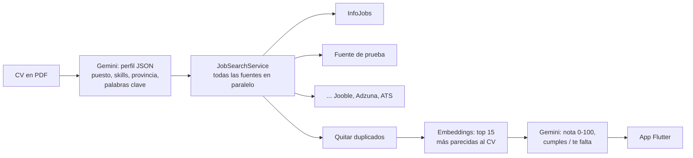

# MatchCV

Sube tu CV en PDF y encuentra las ofertas de empleo que mejor encajan contigo. La IA lee el CV, busca en varias fuentes a la vez, se queda con las ofertas más parecidas y te dice **cuánto encajas, qué cumples y qué te falta** en cada una.

**Stack:** Flutter · Java 21 · Spring Boot 3.5 · Spring AI · Gemini (capa gratuita) · API de InfoJobs

## Cómo funciona



1. **CV → perfil.** Gemini convierte el PDF en un perfil estructurado (salida JSON tipada con `entity()` de Spring AI).
2. **Búsqueda multi-fuente.** Cada fuente implementa `JobSource` y traduce sus datos a un `JobOffer` común. El agregador consulta todas en paralelo (hilos virtuales), aguanta que alguna falle y quita duplicados.
3. **Matching en dos pasos** para gastar poca cuota:
   - **Embeddings** (barato): similitud coseno entre el CV y cada oferta, y se queda con las 15 mejores.
   - **LLM** (caro): una sola llamada puntúa esas 15 y explica la nota.

## Añadir una fuente nueva

Crear un `@Component` que implemente `JobSource`. Nada más cambia: Spring la inyecta en el agregador.

```java
@Component
public class JoobleSource implements JobSource {
    public String name() { return "jooble"; }
    public List<JobOffer> search(JobQuery q) { /* llamar a la API y traducir a JobOffer */ }
}
```

## Por qué no hay scraping de LinkedIn o Indeed

No tienen API pública para buscar ofertas, y hacer scraping va contra sus condiciones de uso. MatchCV usa solo **APIs oficiales**. Para ampliar cobertura de forma legal, las siguientes fuentes previstas son agregadores (Jooble, Adzuna) y los endpoints públicos de los ATS que usan las empresas (Greenhouse, Lever, Personio…).

## Arrancar el backend

Requisitos: Java 21 y una clave gratuita de [Google AI Studio](https://aistudio.google.com/apikey).

```bash
cd backend
export GEMINI_API_KEY=tu_clave            # Windows PowerShell: $env:GEMINI_API_KEY="tu_clave"
./mvnw spring-boot:run
```

Sin claves de InfoJobs funciona con la **fuente de prueba** (ofertas inventadas en `fake-offers.json`). Para usar InfoJobs, registra una app en [developer.infojobs.net](https://developer.infojobs.net) y define `INFOJOBS_CLIENT_ID`, `INFOJOBS_CLIENT_SECRET` y `MATCHCV_FAKE_SOURCE=false`. Ver `backend/.env.example`.

Swagger: http://localhost:8080/swagger-ui.html

| Endpoint | Qué hace |
|---|---|
| `POST /api/match` | CV (multipart `file`, opcional `province`) → perfil + ofertas puntuadas |
| `POST /api/cv/profile` | Solo el perfil que la IA saca del CV |
| `GET /api/offers?keywords=flutter&province=Madrid` | Búsqueda directa en las fuentes, sin IA |
| `GET /api/sources` | Fuentes activas |

Tests (sin clave ni coste, con IA falsa): `./mvnw test`

## Arrancar la app

```bash
cd app
flutter create . --project-name matchcv --platforms android,ios   # solo la primera vez
flutter pub get
flutter run                     # emulador Android: usa http://10.0.2.2:8080
flutter run --dart-define=API_URL=http://IP_DE_TU_PC:8080   # móvil físico
```

## Hoja de ruta

- [x] Versión 1: CV → perfil, matching con embeddings + LLM, InfoJobs, app Flutter
- [ ] Jooble y Adzuna
- [ ] Ofertas de ATS (Greenhouse, Lever, Personio, Teamtailor)
- [ ] Compartir una oferta desde LinkedIn/Indeed a la app para puntuarla
- [ ] Docker
